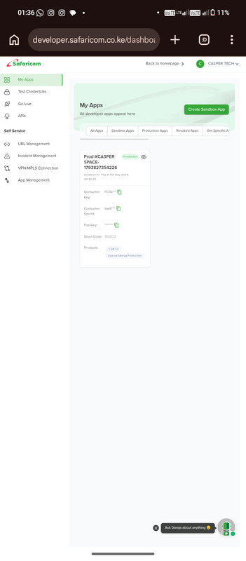

# XCASPER SPACE STK TILL PUSH

A production-ready M-Pesa STK Push checkout for a Safaricom **Buy Goods Till**, built by **Casper-Tech-ke**. The interface is branded as **XCASPER SPACE STK TILL PUSH** and is designed for a clear customer handoff: enter a Kenyan Safaricom number, choose an amount, send the prompt, and monitor the callback outcome.

> This integration uses **M-Pesa Express / Lipa na M-Pesa Online** for customer-facing STK prompts. It is not the separate Business Buy Goods B2B API.

## What the application does

- Sends a customer-facing STK prompt through Safaricom Daraja.
- Uses `CustomerBuyGoodsOnline` for a production Buy Goods Till.
- Maps the production H.O./Store number to `BusinessShortCode` and the actual customer-facing Till to `PartyB`.
- Keeps consumer credentials and the passkey on the server; browser code only calls relative application endpoints.
- Displays pending, successful, cancelled, insufficient-balance, timeout, and failed states.
- Shows a masked recent STK activity feed in the frontend.
- Includes an in-app Daraja setup guide at [`/docs`](./public/docs.html).

## Daraja product and identifier mapping

In the production Daraja app, enable **M-Pesa Express / Lipa na M-Pesa Online** and use its production passkey. The separate **Business Buy Goods** product is a B2B use case and does not replace STK Push.

| Application value | Daraja request field | Production value |
|---|---|---|
| `HO_NUMBER` | `BusinessShortCode` | H.O. or Store number |
| `TILL_NUMBER` | `PartyB` | Actual Buy Goods Till shown to customers |
| Fixed by production mode | `TransactionType` | `CustomerBuyGoodsOnline` |
| Customer input | `PartyA` and `PhoneNumber` | Normalized `2547XXXXXXXX` / `2541XXXXXXXX` |
| Protected runtime value | `CallBackURL` | Public HTTPS callback URL |

The H.O./Store number and Till number must belong to the same merchant structure. Using the Till number for both fields can produce an agent/store mismatch callback error.

## Correct Daraja API calls

### 1. Generate an OAuth token

Production:

```http
POST https://api.safaricom.co.ke/oauth/v1/generate?grant_type=client_credentials
Authorization: Basic base64(CONSUMER_KEY:CONSUMER_SECRET)
Accept: application/json
```

Sandbox uses the same path under `https://sandbox.safaricom.co.ke`.

### 2. Send the STK Push

```http
POST https://api.safaricom.co.ke/mpesa/stkpush/v1/processrequest
Authorization: Bearer ACCESS_TOKEN
Content-Type: application/json
Accept: application/json
```

The server computes `Password` from `BusinessShortCode + Passkey + Timestamp`. The request body has this shape:

```json
{
  "BusinessShortCode": "HO_OR_STORE_NUMBER",
  "Password": "SERVER_GENERATED_BASE64_PASSWORD",
  "Timestamp": "YYYYMMDDHHmmss",
  "TransactionType": "CustomerBuyGoodsOnline",
  "Amount": 10,
  "PartyA": "2547XXXXXXXX",
  "PartyB": "TILL_NUMBER",
  "PhoneNumber": "2547XXXXXXXX",
  "AccountReference": "Till payment",
  "TransactionDesc": "Buy Goods payment",
  "CallBackURL": "https://your-domain.example/api/callback"
}
```

### 3. Receive the callback

Safaricom posts the result to:

```http
POST https://your-domain.example/api/callback
Content-Type: application/json
```

The application immediately returns:

```json
{
  "ResultCode": 0,
  "ResultDesc": "Accepted"
}
```

It then classifies the callback and makes the result available to the frontend through:

```http
GET /api/stk-status/:checkoutRequestId
GET /api/activity
```

## Status handling

| UI state | Meaning |
|---|---|
| Pending | Daraja accepted the prompt request; the customer should check the phone. |
| Successful | Callback `ResultCode` is `0`. |
| Cancelled | Customer cancelled the prompt, including code `1032` or a cancellation description. |
| Insufficient balance | Callback text contains an insufficient-balance or balance failure. |
| Timeout | The prompt expired or no response arrived from the phone. |
| Failed | Safaricom returned another non-success result. |

The activity log masks phone numbers and stores only recent in-memory events. It is intended for the active application session; durable historical reporting should be added with a database or reconciliation workflow.

## Configuration

Create protected runtime values through the project’s secure environment configuration. Do not commit a `.env` file or paste credentials into the frontend.

```env
MPESA_ENV=production
CONSUMER_KEY=...
CONSUMER_SECRET=...
PASSKEY=...
HO_NUMBER=...
TILL_NUMBER=...
CALLBACK_URL=https://your-public-domain.example/api/callback
```

Optional or sandbox-related values:

```env
SHORTCODE=174379
PUSHNUMBER=2547XXXXXXXX
MPESA_TRANSACTION_TYPE=CustomerBuyGoodsOnline
```

In production, `HO_NUMBER` and `TILL_NUMBER` are required. The server refuses a production request when either is missing.

## Local development

```bash
npm install
cp .env.example .env
# Edit .env with your protected Daraja values before production testing.
npm start
```

The server listens on port `3000` by default locally and uses Render’s injected `PORT` automatically when deployed. Useful checks:

```bash
curl http://127.0.0.1:3000/health
curl http://127.0.0.1:3000/api/config
curl http://127.0.0.1:3000/api/activity
```

Open the checkout at `http://127.0.0.1:3000/` and the Daraja guide at `http://127.0.0.1:3000/docs`.

## Render deployment

This repository includes [`render.yaml`](./render.yaml) for a Render Web Service. In Render, create a service from the public `stk-push` repository and use the Blueprint configuration, or enter these values manually:

```text
Build Command: npm install
Start Command: npm start
Health Check Path: /health
Plan: Free for testing, paid for live payment traffic
```

Add every blank value from [`.env.example`](./.env.example) in Render’s Environment settings. After the first deploy, copy the service’s HTTPS URL into `CALLBACK_URL` with `/api/callback` appended, redeploy, and register that exact callback URL in Daraja. Render Free services can sleep after inactivity, so use a paid instance for dependable production payment callbacks.

## Production checklist

1. Create or select the production Daraja app under the correct merchant entity.
2. Add or confirm the **M-Pesa Express / Lipa na M-Pesa Online** product.
3. Obtain the production consumer key, consumer secret, and Lipa na M-Pesa passkey.
4. Confirm the H.O./Store number and the customer-facing Till number from the M-Pesa Business Till structure.
5. Register the exact public HTTPS callback URL in Daraja.
6. Confirm that the callback host is Internet-accessible and does not use a public request tester.
7. Configure the protected runtime values listed above.
8. Test with a real Safaricom mobile number and an explicitly approved amount.
9. Verify the final result from the callback and the M-Pesa/business statement; an HTTP 200 response only means the request was accepted for processing.
10. Never log consumer secrets, passkeys, access tokens, full phone numbers, or raw credentials.

Safaricom states that production callback URLs must be HTTPS and publicly reachable. Sandbox simulation may use HTTP. See the official references below for the current requirements.

## Project structure

```text
.
├── server.js                 # Static server, Daraja proxy, callback and status APIs
├── public/
│   ├── index.html            # XCASPER SPACE checkout UI
│   ├── docs.html             # In-app Daraja setup documentation
│   ├── app.js                # Validation, request flow, polling and activity rendering
│   ├── styles.css            # Dark-blue/green responsive visual system
│   ├── manus-routes.json     # Managed route manifest
│   └── assets/
│       ├── mpesa-logo.png
│       └── proof/             # Supplied evidence screenshots
├── .env.example               # Safe local/Render configuration template
├── .gitignore                 # Secret and local-artifact exclusions
├── render.yaml                # Render Web Service Blueprint
├── app.config.ts              # Managed project logo metadata
├── package.json
└── README.md
```

## Evidence supplied for this project

The following screenshot was provided for the README and copied into `public/assets/proof/`. It documents the Daraja production app context; it is **not** presented as a transaction receipt. The short-code row has been blurred before committing this copy.

### Daraja production app dashboard



[Open the original screenshot](https://i.postimg.cc/PqckfsKp/Screenshot-20261105-013652.png) — the repository copy is the redacted version.

## Official references

- [Safaricom Daraja FAQs](https://developer.safaricom.co.ke/faqs)
- [Daraja Getting Started](https://developer.safaricom.co.ke/apis/GettingStarted)
- [Safaricom M-Pesa Express documentation](https://developer.safaricom.co.ke/apis/MpesaExpressSimulate)
- [Safaricom Lipa na M-Pesa sample discussion on Till identifiers](https://github.com/safaricom/LNMOnlineAndroidSample/issues/8)
- [Safaricom Business Till guide](https://www.safaricom.co.ke/images/Downloads/the-mpesa-business-till-guide.pdf)

## Developer links

- [Casper-Tech-ke on GitHub](https://github.com/Casper-Tech-ke/)
- [Instagram — @xcasper.space](https://www.instagram.com/xcasper.space/)
- [Telegram — @xcasperspace](https://t.me/xcasperspace)
- [Website — xcasper.space](https://xcasper.space)

## Live site

The deployed checkout is available at [stk.xcasper.space](https://stk.xcasper.space). The site uses a public HTTPS callback at `https://stk.xcasper.space/api/callback` for the production Daraja integration.

## Acknowledgements

This project is owned by [Casper-Tech-ke](https://github.com/Casper-Tech-ke/). It is based on the original STK implementation by [Fortunatusmokaya](https://github.com/Fortunatusmokaya), with knowledge and ideas contributed by [mauricegift](https://github.com/mauricegift), and watch-over, review, and support by [kkeizza](https://github.com/kkeizza/).

The site is improved and maintained by **SPACE TECH KE DEVS**.

## Security note

This project handles live payment requests. Keep all production credentials in protected runtime configuration, use HTTPS callbacks, avoid duplicate retries, verify callback results before marking a payment successful, and reconcile successful transactions against the merchant statement.
